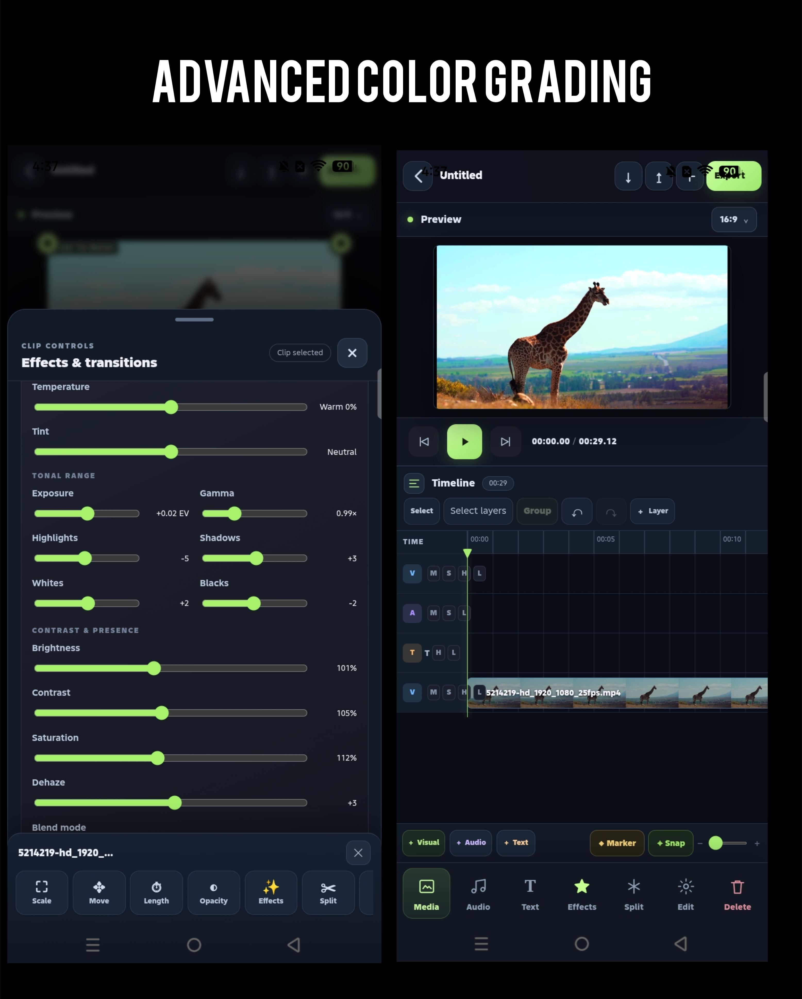

# Strobecut-android
StrobeCut — Professional Video Editing, Made for Mobile

StrobeCut is a mobile video editing app built for creators who want more control over their videos without needing a computer or complicated desktop software. Whether you're making cinematic edits, social media content, gaming videos, documentaries, travel videos or short films, StrobeCut brings together the tools you need to turn your footage into something that feels truly your own.

At its heart, StrobeCut is designed around a proper timeline-based editing experience. Instead of limiting you to a few simple templates and filters, it gives you the freedom to work with multiple clips, images, audio tracks and text layers in one project. You can arrange your footage, trim clips, adjust timing, build transitions and work with different layers to create edits that match your vision. The goal is to give mobile creators more creative freedom and make detailed editing feel comfortable on a touchscreen.

Color grading is one of the areas where StrobeCut puts a strong emphasis on creative control. Its grading workspace includes tools for exposure, contrast, highlights, shadows, white balance, RGB curves, color wheels and HSL adjustments. You can work with LUTs, make selective color corrections and use scopes to help understand the image you're working with. Whether you're going for a natural look, a cinematic atmosphere, rich colors or a completely different visual style, you have room to shape the image instead of relying on a preset to do everything for you.

StrobeCut also includes a dedicated chroma key feature for removing green or blue backgrounds and creating composite scenes. With controls for color selection, tolerance, feathering and spill suppression, you can refine the result and combine footage with other visual layers. This opens up more possibilities for creators who want to experiment with backgrounds, overlays and visual effects.

Audio is just as important as the visuals. StrobeCut's audio workspace brings sound editing into the main editing experience, with tools for clip volume, stereo panning, equalization, compression, limiting, reverb and volume automation. You can shape the sound of individual clips, balance different audio elements and make adjustments directly within your project. Instead of treating audio as an afterthought, StrobeCut gives it its own dedicated workspace.

For creators who enjoy adding movement and personality to their edits, the app also includes keyframe-based controls, transitions, text and visual effects. These tools make it possible to animate elements, build more interesting sequences and create edits that go beyond simple cuts. You can experiment with timing, movement, color and sound until the result feels right.

The interface follows a dark black-and-green visual theme, with touch-friendly controls and dedicated editing panels. It is designed specifically for mobile use, keeping important tools accessible while giving you space to work on the timeline. The idea is not simply to shrink a desktop editor onto a phone, but to build an editing experience that makes sense on a touchscreen.

StrobeCut is made for people who want to take mobile editing further. It is for creators who enjoy experimenting with color, people who care about the details of their audio, editors who work with multiple layers, and anyone who wants more control over the final result.

From arranging the first clip to making the final color adjustments and preparing the export, StrobeCut brings video, audio, effects and creative control together in one mobile editing workspace.

Your footage. Your style. Your timeline. Your edit.

StrobeCut — Create beyond the ordinary.

## Screenshots

